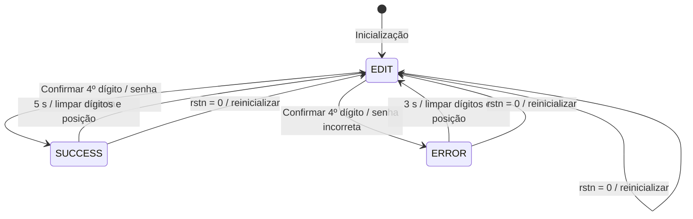

# SafeCrackPro

Projeto de uma fechadura digital implementada em **SystemVerilog** para a placa DE2-115. A entrada da senha é feita pelos botões da placa, um dígito por vez. A máquina de estados verifica a combinação e sinaliza o resultado por meio dos LEDs.

> **Escopo desta documentação:** este README foi elaborado a partir do módulo `safecrackpro_fsm.sv` enviado. A integração com o módulo top-level, a associação física dos botões e dos displays de sete segmentos e o funcionamento do conversor BCD/7 segmentos precisam ser conferidos nos respectivos arquivos do projeto.

## 1. Funcionalidades implementadas

- Entrada de uma senha numérica de quatro dígitos.
- Edição do dígito selecionado por meio das operações de incrementar e decrementar.
- Avanço para o próximo dígito após a confirmação do dígito atual.
- Verificação da combinação completa ao confirmar o quarto dígito.
- Sinalização de senha correta pelos LEDs verdes.
- Sinalização de senha incorreta pelos LEDs vermelhos.
- Retorno automático ao modo de edição após o tempo de sinalização.
- Reinicialização assíncrona do sistema por meio de `rstn`.

## 2. Organização do módulo

O módulo principal da lógica de controle é `safecrackpro_fsm`, parametrizado por `CLK_HZ`, que representa a frequência do clock em hertz.

### Entradas

| Sinal | Largura | Descrição |
|---|---:|---|
| `clk` | 1 bit | Clock utilizado pela lógica sequencial. |
| `rstn` | 1 bit | Reset assíncrono ativo em nível baixo. Quando `rstn = 0`, a FSM retorna ao estado `EDIT` e limpa os registradores principais. |
| `btn` | 3 bits | Entradas dos botões. O código considera os botões ativos em nível baixo e inverte o vetor para detectar o pressionamento. |

### Saídas

| Sinal | Largura | Descrição |
|---|---:|---|
| `digits` | 4 dígitos de 4 bits | Armazena os quatro dígitos que estão sendo digitados. |
| `current_position_idx` | 2 bits | Indica qual posição está sendo editada, de 0 a 3. |
| `led_red` | 18 bits | LEDs vermelhos; todos são acionados no estado `ERROR`. |
| `led_green` | 9 bits | LEDs verdes; todos são acionados no estado `SUCCESS`. |

## 3. Como os requisitos foram implementados

### 3.1. Armazenamento e edição da senha

O vetor `digits` armazena quatro valores, cada um com quatro bits. Cada posição representa um algarismo decimal entre 0 e 9. A senha definida no código é:

```systemverilog
localparam logic [15:0] PASSWORD = 16'h1234;
```

O registrador `current_position_idx` indica o dígito atualmente selecionado. Após o reset, ele começa em `0`, apontando para a primeira posição.

A edição é feita sobre a posição selecionada:

- **Incrementar (`btn_edge = 3'b010`):** soma 1 ao dígito atual. Se ele já for `9`, retorna para `0`.
- **Decrementar (`btn_edge = 3'b100`):** subtrai 1 do dígito atual. Se ele já for `0`, retorna para `9`.

O acesso `digits[current_position_idx]` permite que a mesma lógica altere qualquer uma das quatro posições, sem precisar de um bloco separado para cada dígito.

### 3.2. Confirmação e avanço entre posições

A confirmação é identificada quando `btn_edge = 3'b001`.

- Se `current_position_idx` for menor que `3`, o índice é incrementado e a edição passa para o próximo dígito.
- Se `current_position_idx` for igual a `3`, significa que o quarto dígito está selecionado. Nesse momento, a FSM compara a concatenação dos quatro dígitos com `PASSWORD`.

A comparação implementada é:

```systemverilog
{digits[0], digits[1], digits[2], digits[3]} == PASSWORD
```

Se a comparação for verdadeira, a FSM vai para `SUCCESS`. Caso contrário, vai para `ERROR`.

### 3.3. Detecção do pressionamento dos botões

O código primeiro inverte as entradas:

```systemverilog
assign btn_pos = ~btn;
```

Essa inversão considera botões ativos em nível baixo: em repouso, a entrada física fica em `1`; ao pressionar, passa para `0`. Após a inversão, o pressionamento passa a ser representado por uma transição de `0` para `1`.

O registrador `btn_prev` guarda o valor anterior de `btn_pos`. A expressão abaixo identifica os bits que acabaram de mudar para `1`:

```systemverilog
assign btn_edge = btn_pos & ~btn_prev;
```

Assim, a lógica de edição reage à borda de pressionamento, e não permanece repetindo a operação enquanto o botão estiver pressionado. O mapeamento indicado pelos comentários do código é:

| `btn_edge` | Ação |
|---|---|
| `3'b001` | Confirmar o dígito atual. |
| `3'b010` | Incrementar o dígito atual. |
| `3'b100` | Decrementar o dígito atual. |

### 3.4. Estados de sucesso e erro

Quando a senha é confirmada, a FSM deixa o modo de edição e entra em um dos estados de resultado:

- **`SUCCESS`:** aciona todos os nove LEDs verdes e mantém essa indicação durante `SUCCESS_TIME` ciclos de clock.
- **`ERROR`:** aciona todos os dezoito LEDs vermelhos e mantém essa indicação durante `ERROR_TIME` ciclos de clock.

Os tempos são definidos em função da frequência do clock:

```systemverilog
localparam logic [31:0] SUCCESS_TIME = CLK_HZ * 5;
localparam logic [31:0] ERROR_TIME   = CLK_HZ * 3;
```

Com o valor padrão `CLK_HZ = 50_000_000`, o estado `SUCCESS` dura aproximadamente 5 segundos e o estado `ERROR`, aproximadamente 3 segundos.

Ao atingir o tempo correspondente, a FSM retorna a `EDIT`, limpa `digits`, retorna `current_position_idx` para `0` e zera `timer`.

### 3.5. Controle dos LEDs

O bloco `always_comb` define inicialmente todos os LEDs como desligados. Em seguida:

- Quando `state == SUCCESS`, `led_green` recebe `9'b111111111`.
- Quando `state == ERROR`, `led_red` recebe `18'b111111111111111111`.

Como os valores padrão são zero, os LEDs ficam apagados durante a edição e os LEDs do resultado oposto permanecem desligados.

### 3.6. Reset

O bloco sequencial é sensível à borda de subida do clock e à borda de descida de `rstn`:

```systemverilog
always_ff @(posedge clk or negedge rstn)
```

Quando `rstn` vai para `0`, independentemente do clock, são inicializados:

- `state` com `EDIT`;
- `digits` com zero;
- `current_position_idx` com zero;
- `timer` com zero;
- `btn_prev` com zero.

## 4. Diagrama de estados

O diagrama abaixo foi disponibilizado como parte dos materiais do projeto e representa o fluxo principal: a FSM permanece em `EDIT` durante a entrada da senha; ao confirmar o quarto dígito, segue para `SUCCESS` ou `ERROR`; após o tempo de sinalização, retorna à edição com os dígitos e a posição reinicializados.


[Ver o diagrama de estados em PDF](docs/diagrama_estados_original.pdf).

A mesma lógica pode ser representada de forma textual pelo diagrama Mermaid:



### Resumo dos estados

| Estado | Comportamento | Condição de saída |
|---|---|---|
| `EDIT` | Permite incrementar, decrementar e confirmar os dígitos. | Confirmação do quarto dígito leva a `SUCCESS` ou `ERROR`, conforme a senha. |
| `SUCCESS` | Acende todos os LEDs verdes e conta o tempo de sucesso. | Ao completar `SUCCESS_TIME`, retorna a `EDIT` e limpa a entrada. |
| `ERROR` | Acende todos os LEDs vermelhos e conta o tempo de erro. | Ao completar `ERROR_TIME`, retorna a `EDIT` e limpa a entrada. |

## 5. Diagramas de tempo da simulação (waveforms)

A captura abaixo foi obtida na simulação do projeto e registra a interação com os botões e as saídas dos displays. Ela demonstra a confirmação do primeiro dígito e a mudança da posição selecionada para o segundo dígito.

### 5.1. Confirmação do primeiro dígito e avanço de posição


Na posição do cursor indicada pela ferramenta (aproximadamente `178785 ps`), a captura apresenta os seguintes valores:

| Sinal | Valor observado | Interpretação |
|---|---|---|
| `clk` | `1` | O clock está em nível alto no instante do cursor. |
| `KEY` | `1101` | `KEY[1]` está em nível baixo, indicando o acionamento do botão de confirmação (entradas físicas ativas em nível baixo). |
| `led_green` | `000000000` | Os nove LEDs verdes estão apagados. |
| `led_red` | `000000000000000000` | Os dezoito LEDs vermelhos estão apagados. |
| `seg_pos1` | `1001111` | Padrão de sete segmentos correspondente ao dígito `1` no decodificador de ânodo comum utilizado. |
| `seg_pos2` | `0000001` | Padrão correspondente ao dígito `0`. |
| `seg_pos3` | `0000001` | Padrão correspondente ao dígito `0`. |
| `seg_pos4` | `0000001` | Padrão correspondente ao dígito `0`. |
| `seg_cur_pos` | `0010010` | Padrão correspondente ao número `2`, indicando a segunda posição como selecionada. |

O resultado é compatível com a seguinte sequência: o primeiro dígito foi ajustado para `1`; ao pressionar `KEY[1]`, a confirmação é reconhecida e a posição selecionada avança de `1` para `2`. Os demais dígitos continuam em `0`, e nenhum LED de resultado é acionado nesse trecho.

**Limite desta evidência:** a captura não apresenta diretamente os sinais internos `state`, `digits`, `current_position_idx` ou `timer`. Portanto, ela demonstra os sinais externos dos botões, displays e LEDs, mas não permite observar diretamente a codificação interna do estado nem validar os temporizadores de sucesso e erro.

### 5.2. Cenários adicionais recomendados para a simulação

Para documentar a validação completa dos requisitos, recomenda-se acrescentar capturas que mostrem:

- **Reset:** `rstn`, `state`, `digits`, `current_position_idx` e `timer`, verificando a inicialização assíncrona.
- **Incremento e decremento circular:** demonstrar as transições `9 → 0` e `0 → 9` no dígito selecionado.
- **Senha correta:** confirmar `1234`, observar a entrada em `SUCCESS`, os nove LEDs verdes acesos e o retorno à edição após cinco segundos simulados.
- **Senha incorreta:** confirmar uma combinação diferente de `1234`, observar a entrada em `ERROR`, os dezoito LEDs vermelhos acesos e o retorno à edição após três segundos simulados.

Para facilitar a leitura, inclua nas próximas capturas os sinais internos `dut.state`, `dut.digits`, `dut.current_position_idx` e `dut.timer`, além dos sinais externos relevantes. Se os nomes de hierarquia forem diferentes no testbench, utilize os nomes correspondentes.

## 6. Bugs conhecidos e limitações (Known Issues)

Os itens abaixo são limitações identificáveis no código atual. Alguns podem se manifestar como comportamento incorreto dependendo dos botões e da integração com a placa.

1. **Ausência de debounce dos botões:** o circuito detecta bordas, mas não filtra oscilações mecânicas do botão. Um único pressionamento pode gerar mais de um evento caso ocorram múltiplas transições durante o bounce.
2. **Ausência de sincronizadores nas entradas dos botões:** `btn` é utilizado diretamente na lógica de detecção. Como os botões são sinais externos e assíncronos em relação a `clk`, existe possibilidade de metastabilidade. Recomenda-se sincronização antes da detecção de borda.
3. **Pressionamento simultâneo de botões:** o `case` reconhece somente `3'b001`, `3'b010` e `3'b100`. Combinações com mais de um bit ativo não correspondem a nenhuma dessas opções e são ignoradas pelo `default`.
4. **Senha fixa no código:** a combinação `1234` está definida em `PASSWORD`. Para alterar a senha, é necessário modificar esse parâmetro local no módulo.
5. **Dependência da frequência do clock:** os tempos de sucesso e erro dependem de `CLK_HZ`. Se o valor configurado não corresponder à frequência real do clock da placa, a duração das indicações será diferente de 5 e 3 segundos.
6. **Sem retorno para uma posição anterior:** a lógica implementada permite avançar pelas posições, mas não possui uma operação para voltar e editar um dígito já confirmado, sem reiniciar o processo.

## 7. Arquivos do projeto

A estrutura abaixo é uma sugestão de organização para o repositório. Ajuste os nomes conforme os arquivos realmente utilizados:

```text
SafeCrackPro/
├── README.md
├── safecrackpro_fsm.sv
├── safecrackpro_top.sv
├── bcd_to_7segment_anodo.sv
└── docs/
    └── waveforms/
        ├── reset.png
        ├── edicao.png
        ├── success.png
        └── error.png
```

## 8. Parâmetros e configuração

| Parâmetro | Valor padrão | Finalidade |
|---|---:|---|
| `CLK_HZ` | `50_000_000` | Frequência do clock em hertz, utilizada para calcular os tempos de sucesso e erro. |
| `PASSWORD` | `16'h1234` | Senha utilizada na comparação dos quatro dígitos. |
| `SUCCESS_TIME` | `CLK_HZ * 5` | Quantidade de ciclos correspondente a cinco segundos. |
| `ERROR_TIME` | `CLK_HZ * 3` | Quantidade de ciclos correspondente a três segundos. |

## 9. Observações

Este README descreve o comportamento observado no módulo `safecrackpro_fsm.sv`. Antes da entrega, confira se os nomes dos arquivos e a descrição das conexões correspondem à versão final do repositório. Complete a seção de waveforms com capturas reais da simulação e, caso existam outros módulos ou restrições de implementação relevantes, documente-os também.
